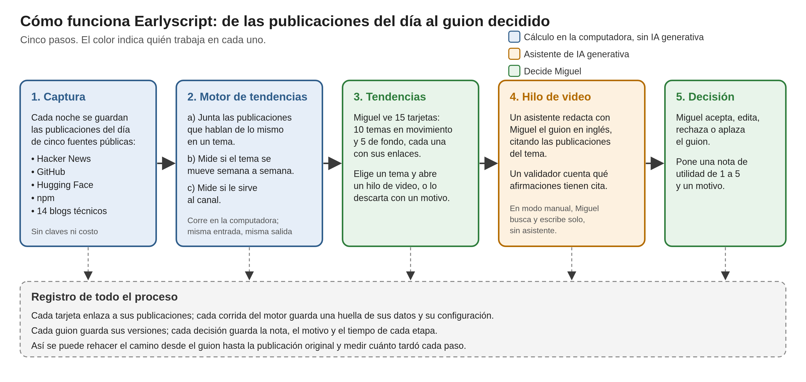

# Earlyscript

Earlyscript es un estudio editorial para una persona que decide, cada día, sobre qué tema grabar un video. Propone cada mañana los temas que se mueven en comunidades técnicas públicas y acompaña la escritura del guion, con la decisión final en manos del operador. Earlyscript es un fork de [T3 Code](https://github.com/pingdotgg/t3code) (licencia MIT), tomado del commit `aa11ef6783` del 30 de octubre de 2026. El README original de T3 Code se conserva en [`docs/README-t3code.md`](docs/README-t3code.md).

## Problema

Quien publica videos sobre tecnología tiene que decidir cada semana de qué hablar. Sin una herramienta, eso significa recorrer foros, repositorios y blogs, juntar enlaces y comparar temas a mano. Ese trabajo lleva varias horas a la semana. Al final, además, no queda rastro de qué se revisó ni de por qué se eligió un tema y no otro.

## Cómo funciona



Earlyscript hace de noche la parte mecánica de esa búsqueda. Por la mañana, el operador encuentra una lista corta de temas que se mueven, cada uno con sus publicaciones enlazadas. Elige uno y escribe el guion con un asistente que cita esas publicaciones, o lo escribe solo. El tiempo se dedica a decidir y a escribir, no a buscar.

La decisión final es siempre del operador. Queda guardada con su nota, su motivo y el tiempo de cada etapa, y cada guion se puede seguir hasta las publicaciones que lo originaron. En el diagrama, el azul es cálculo en la computadora sin IA generativa, el naranja es el asistente y el verde son las decisiones del operador.

## Propósito académico

Earlyscript es el prototipo del proyecto de titulación "Arnés agéntico basado en modelos de lenguaje y análisis semántico de tendencias para priorizar ideas de contenido en YouTube orientadas a la adquisición de miembros para SingulariDev" (Miguel Ángel Brito Espejo, Maestría en Inteligencia Artificial Aplicada, Universidad de Las Américas, 2026; auspiciante Bistec LLC). Los resultados de la evaluación están en el informe final del proyecto, no en este repositorio.

## Versión evaluada

La versión evaluada en la tesis es el commit `ded88d5a8b`, con la etiqueta `motor-v3-pares`. Corre el motor v3 con la configuración [`packages/trend-engine/config/engine.v3-sel.json`](packages/trend-engine/config/engine.v3-sel.json) (`config_hash` `sha256:03b32be8…`) y el perfil del canal v2. Esa combinación se congeló el 9 de noviembre de 2026, antes de sortear los seis pares de ejercicios del operador.

Qué hace el motor v3:

- **Fuentes.** Captura seis fuentes públicas por día UTC: Hacker News, GitHub, Hugging Face, npm, 14 blogs por RSS y Wikipedia. Agrupa las cinco primeras. Wikipedia se guarda pero no se agrupa, porque su texto fijo formaba grupos de miles de páginas.
- **Agrupamiento.** Convierte cada titular, con hasta 1.000 caracteres de cuerpo, en un vector con Qwen3-Embedding-0.6B en local. Une cada publicación al tema más parecido (coseno mayor que 0,70) o abre uno nuevo.
- **Movimiento.** Cuenta las publicaciones de cada tema por semana y fuente durante 35 días. Le asigna un movimiento: nueva, señal débil, señal fuerte, rebote, en caída o estable. La popularidad pierde peso con los días, como en BERTrend.
- **Encaje.** Una sonda logística sobre los vectores ([`config/relevance.v2.json`](packages/trend-engine/config/relevance.v2.json)) da a cada titular una relevancia de 0 a 1 para la audiencia. El perfil del canal descarta los temas que caen en sus exclusiones.
- **Tarjeta breve.** Emite 10 temas "En movimiento" y 5 temas "De fondo". Cada tarjeta dice en tres líneas cómo se mueve el tema y desde cuándo, cuántas publicaciones tuvo por semana y fuente, con qué tema del perfil encaja, su saturación y dos enlaces. El detalle y la evidencia van en un desplegable.

Ningún modelo de lenguaje participa en capturar, agrupar ni ordenar. Con la misma entrada, el motor da la misma salida, y cada corrida guarda una huella que permite comprobarlo. El modelo de lenguaje solo interviene en el hilo de video, cuando el operador escribe con un agente.

`main` contiene además `engine.v2.json` y un laboratorio del motor (`packages/engine-lab/`), apagados. No forman parte de la versión evaluada.

## Versión entregada

La versión entregada con la tesis es la etiqueta `entrega-final`, sobre `main`. Usa el mismo motor v3 que la versión evaluada: no cambia la captura, el agrupamiento, el movimiento, el encaje ni la tarjeta breve. Después de la evaluación mejoramos la interfaz que rodea al motor:

- **Resultados.** Pasa a un botón de la barra lateral. Abre con tres tarjetas que responden primero (tiempo por guion, utilidad y afirmaciones con cita), con una línea que resume la muestra y sus límites, y deja filtrar las decisiones por cohorte, modo y página.
- **Ficha de tendencia.** Una página por tema con el relato de la noticia, el movimiento por semana y fuente, el panel de decisión, la evidencia enlazada y la procedencia de la corrida.
- **Hilo de video.** Los tres pasos del reloj quedan arriba; Tema, Guion y Fuentes a la izquierda, con una sola numeración de fuentes; el asistente abre cada fuente en el navegador integrado; la decisión, con sus opciones explicadas y la escala de utilidad con sus anclas, y los detalles del tiempo por paso quedan a la derecha.
- **Primer arranque.** Un recorrido que explica cada paso, descarga el modelo local, permite seguir más tarde y lanza la primera revisión nocturna sin intervención.
- **Ajustes.** Editorial se reparte en cinco páginas por tarea: Mi canal, Fuentes, Revisión nocturna, Redacción y Mis datos. Sin una elección previa, la revisión nocturna usa el método evaluado, `engine.v3-sel.json`, y registra esa elección.

Para reproducir los resultados de la tesis, usar `motor-v3-pares`. Para usar la herramienta, usar `entrega-final` o `main`.

## Requisitos

- macOS arm64 (macOS 27 probado) o Linux x86_64 (Debian 13 probado).
- Node 26.12.1 y pnpm 12.14.0 (`engines` y `packageManager` del `package.json` raíz).
- Unos 2 GB de memoria por proceso de embeddings. El motor usa dos procesos por defecto.
- Un agente de código instalado y con sesión iniciada, por ejemplo Claude Code o Codex, para el hilo de video asistido. Earlyscript usa los agentes instalados, como T3 Code, y no pide claves de API.
- Ninguna clave para las fuentes. `GITHUB_TOKEN` es opcional y solo amplía la cuota de GitHub.
- El modelo `onnx-community/Qwen3-Embedding-0.6B-ONNX`, revisión `c25a394`, cuantizado q8 (unos 600 MB). Se descarga de Hugging Face una sola vez en `~/earlyscript-data/models/`, en la primera corrida o con `engine model prepare`.
- Para compilar la app de macOS: Xcode Command Line Tools y Rust con el target `aarch64-apple-darwin` ([`docs/earlyscript-macos.md`](docs/earlyscript-macos.md)). Para la batería completa en Linux: [`docs/dev-environment-linux.md`](docs/dev-environment-linux.md).

## Paso a paso

Los comandos se ejecutan desde la raíz del checkout. `pnpm --filter` ejecuta cada script dentro de su paquete, así que las rutas que se le pasan deben ser absolutas. Si la terminal se abrió desde T3 Code, conviene anteponer `env -u T3CODE_HOME` para no usar los datos de ese T3 Code.

### 1. Instalar

```sh
git clone https://github.com/mickroplastics/earlyscript.git
cd earlyscript
git checkout motor-v3-pares        # la versión evaluada; omitir para usar main
pnpm install --frozen-lockfile
pnpm es:typecheck
pnpm es:test                       # pruebas de los paquetes propios y de los módulos que tocan
```

### 2. Arrancar la aplicación

En desarrollo:

```sh
pnpm dev
```

Los puertos base son 14773 para el servidor y 5743 para la web. Pueden cambiar según el worktree y la disponibilidad: el log muestra los puertos efectivos y la URL de emparejamiento. En desarrollo, la app usa el motor del propio checkout.

Como aplicación de escritorio, que lleva el motor dentro:

```sh
pnpm es:build
pnpm dist:desktop:dmg:arm64        # macOS; pnpm dist:desktop:linux en Linux (AppImage)
```

El motor solo se incluye si se compila en la misma plataforma y arquitectura que el destino. Las aplicaciones no están firmadas. La instalación, la apertura sin firma y la ubicación de cada dato en macOS están en [`docs/earlyscript-macos.md`](docs/earlyscript-macos.md).

### 3. Preparar el perfil del canal

El perfil v2 del canal está en el repositorio, en [`packages/trend-engine/judge/profile.singularidev.v2.json`](packages/trend-engine/judge/profile.singularidev.v2.json). `engine.v3-sel.json` exige su huella exacta (`sha256:cc5cc20d…`), así que se copia byte a byte y no se edita.

```sh
mkdir -p ~/earlyscript-data/profiles
cp packages/trend-engine/judge/profile.singularidev.v2.json ~/earlyscript-data/profiles/
shasum -a 256 ~/earlyscript-data/profiles/profile.singularidev.v2.json   # cc5cc20d…
```

### 4. Capturar fuentes

```sh
pnpm --filter @earlyscript/trend-engine engine collect \
  --corpus ~/earlyscript-data/corpus \
  --sources hn,github,huggingface,npm,wikipedia,rss \
  --from 2026-10-05 --to 2026-11-09
```

`--from` incluye el día y `--to` lo excluye. El motor v3 mira 35 días antes del corte, así que el ejemplo captura 35 días para un corte el 9 de noviembre. Cada fuente y día queda marcado como completo, parcial o no disponible en `coverage.jsonl`. El corpus lleva un manifiesto con la huella SHA-256 de cada archivo. La captura no ejecuta modelos. `--rss-feeds <archivo.json>` cambia la lista de blogs, que por defecto es la de [`src/sources/rss-feeds.ts`](packages/trend-engine/src/sources/rss-feeds.ts).

### 5. Correr el motor v3

```sh
pnpm --filter @earlyscript/trend-engine engine model prepare      # opcional: descarga el modelo antes
pnpm --filter @earlyscript/trend-engine engine run \
  --corpus ~/earlyscript-data/corpus \
  --cutoff 2026-11-09T00:00:00Z \
  --config "$PWD/packages/trend-engine/config/engine.v3-sel.json" \
  --profile ~/earlyscript-data/profiles/profile.singularidev.v2.json \
  --out ~/earlyscript-data/runs --workers 2
```

El corte debe caer a las 00:00 UTC. El comando imprime una línea JSON con `run_id`, `status`, el número de expedientes y `logical_hash`. La corrida queda en `~/earlyscript-data/runs/<run_id>/`: `run.json` con el corte, la configuración y su hash, el perfil y su hash, la cobertura y los tiempos, y un expediente por tema en `dossiers/`, con esquema `dossier/2`. Los vectores se guardan en una caché (`~/earlyscript-data/embeddings/embeddings.sqlite`): la primera corrida tarda más y las siguientes reutilizan lo calculado.

### 6. Comprobar una corrida

```sh
RUN=~/earlyscript-data/runs/<run_id>
pnpm --filter @earlyscript/trend-engine engine check --run "$RUN"
pnpm --filter @earlyscript/trend-engine engine check --run "$RUN" \
  --rerun --out ~/earlyscript-data/reruns
```

Sin `--rerun`, `check` valida los expedientes y recalcula su huella. Con `--rerun`, repite la corrida con la configuración, el corpus y el perfil que registró `run.json`, y compara la huella lógica de las dos. Por eso el corpus y el perfil deben seguir en la misma ruta. `--expect <logical_hash>` compara además con una huella conocida. La huella lógica cubre los expedientes sin sus identificadores ni fechas de creación. Los vectores de macOS arm64 y de Linux x86_64 difieren un poco, así que una corrida se compara consigo misma en la misma plataforma.

### 7. Usar el motor v3 en la aplicación

La aplicación captura las fuentes, corre el motor, comprueba la corrida y la importa cada noche, o al pulsar "Ejecutar ahora". Para que use la versión evaluada:

1. Abrir la app una vez, para que aplique sus migraciones, y cerrarla.
2. Importar el perfil v2 con sus bytes exactos. Guardarlo desde Ajustes lo reescribe y cambia su huella.

   ```sh
   node apps/server/src/bin.ts profile import --base-dir ~/.earlyscript \
     --file ~/earlyscript-data/profiles/profile.singularidev.v2.json \
     --expect sha256:cc5cc20d8be7faa6eb28eaa09b35fb8200e61da269acdaefac85cf3ecd0e2298
   ```

3. Abrir la app. En Ajustes › Editorial › Fuentes, activar la captura de Hacker News, GitHub, Hugging Face, npm, Wikipedia y RSS.
4. Comprobar en Ajustes › Editorial › Revisión nocturna › Avanzado que el método elegido es `engine.v3-sel.json`. En `entrega-final`, sin una elección previa, la app lo elige sola. En `motor-v3-pares` hay que elegirlo en Ajustes › Editorial › Corrida nocturna › Configuración del motor; sin una elección explícita, esa versión corre `engine.v1.json`. Cada cambio queda registrado con su hora.
5. Pulsar "Ejecutar ahora". Las fases son captura, corrida, comprobación con repetición e importación. Las tarjetas aparecen en el espacio Tendencias.

Si el corpus de la app tiene menos de 35 días, los temas salen con filas parciales o no comparables. `engine corpus import --from <corpus> --to ~/earlyscript-data/live (--backup <carpeta nueva> | --dry-run) --sources <ids>` copia días históricos de otro corpus, por fuente y día, con respaldo previo.

### 8. Validar un guion

```sh
pnpm --filter @earlyscript/editorial-script check \
  /ruta/absoluta/guion.md --dossier /ruta/absoluta/expediente.json
```

El guion lleva `# Hook`, bloques `# Block 1` en adelante, `# Close` y, si se quiere, `# Sources`. Las citas tienen la forma `[itm_hn_50061234]`. El validador cuenta las afirmaciones con y sin cita. No comprueba que la fuente respalde la afirmación. El formato completo está en [`packages/editorial-script/README.md`](packages/editorial-script/README.md#formato).

## Dónde quedan los datos

Nada de esto se versiona.

| Qué                                                    | Ruta                                                            |
| ------------------------------------------------------ | --------------------------------------------------------------- |
| Estado de la app: hilos, `editorial.sqlite`, registros | `~/.earlyscript/userdata/`                                      |
| Corpus que captura la app                              | `~/earlyscript-data/live/` (`EARLYSCRIPT_EDITORIAL_CORPUS_DIR`) |
| Corridas que lee el espacio Tendencias                 | `~/earlyscript-data/runs/` (`EARLYSCRIPT_EDITORIAL_RUNS_DIR`)   |
| Modelo de embeddings                                   | `~/earlyscript-data/models/<revisión>/`                         |
| Caché de embeddings                                    | `~/earlyscript-data/embeddings/embeddings.sqlite`               |

## Decisiones y tiempos

Solo el operador decide. Sobre una tendencia, puede crear un hilo de video, seguir observándola o descartarla. Sobre un guion, puede aceptarlo, editarlo, rechazarlo o aplazarlo, con una nota de utilidad de 1 a 5 y un motivo obligatorio. El agente no puede registrar decisiones.

Cada decisión queda en `editorial.sqlite`, ligada a la corrida, al expediente y a la versión del guion que la produjeron. Un reloj mide el tiempo activo por etapa y se detiene con la decisión. El hilo manual tiene navegador integrado y editor, y el servidor impide que actúe un agente en él. El modo pares (Ajustes › Editorial › Revisión por pares) oculta cualquier indicio del origen de cada tarjeta, y la exportación ciega prepara los guiones para revisores externos. Los resultados de la tesis se leyeron en solo lectura de esa base.

## Limitaciones

- El motor necesita 35 días de historia por fuente para comparar semanas. Con menos, las filas salen parciales o no comparables.
- La cobertura de GitHub, Hugging Face y npm siempre es parcial: cada consulta trae una muestra del día ordenada por popularidad actual. Un RSS solo lista sus últimas entradas. Al capturar días pasados, estas fuentes no reconstruyen lo que se sabía entonces.
- Las fuentes son técnicas y en inglés. Muchas historias de Hacker News no tienen cuerpo, así que la evidencia suele ser un titular.
- La relevancia la da una sonda entrenada con etiquetas de un juez basado en un modelo de lenguaje. La utilidad de la configuración elegida la estimaron jueces del mismo tipo, comparados con el operador solo en si un tema encaja con el canal.
- Las tarjetas son apoyo de lectura, no una predicción. El motor no demostró ventaja frente a una lista por palabras clave del perfil.
- Los vectores, y por tanto las huellas, dependen de la plataforma.

## Fuentes y condiciones de uso

- Hacker News por la API pública de Algolia: historias, sin comentarios. Los términos de Y Combinator restringen el uso comercial y la redistribución. El corpus se guarda en local y no se redistribuye.
- GitHub por su API de búsqueda: repositorios creados cada día con 20 estrellas o más.
- Hugging Face: modelos creados cada día y artículos destacados del día.
- npm: paquetes publicados cada día, por búsqueda de palabras clave en el registro.
- RSS: 14 blogs técnicos sobre IA y programación.
- Wikipedia: lista de páginas más vistas, sin texto de artículos.
- Los textos guardan nombres públicos de autores. No se recogen comentarios ni datos de cuentas. `engine purge` borra registros de un autor, de una URL o de un feed.
- Al proveedor del agente solo llega lo que el operador escribe o adjunta en el hilo, y los títulos y resúmenes que pida al asistente. Telemetría, analítica y comprobación de actualizaciones de T3 Code están apagadas.

## Organización del repositorio

| Carpeta                                                         | Contenido                                                                                                                                       |
| --------------------------------------------------------------- | ----------------------------------------------------------------------------------------------------------------------------------------------- |
| `packages/editorial-contracts/`                                 | Esquemas de ítem, fuente, corrida, expediente (`dossier/1` y `dossier/2`), perfil y decisión                                                    |
| `packages/trend-engine/`                                        | Motor: fuentes, corpus, embeddings, agrupamiento, movimiento, relevancia, corrida y comprobación; CLI `engine`. Configuraciones en `config/`    |
| `packages/editorial-script/`                                    | Validador del guion; CLI `check`                                                                                                                |
| `packages/engine-lab/`                                          | Laboratorio de variantes del motor, apagado en la versión evaluada                                                                              |
| `apps/server/src/editorial/`                                    | Base `editorial.sqlite` con sus migraciones, corrida nocturna, importación de corridas, hilo de video, reloj, decisiones y CLI `profile import` |
| `apps/web/src/editorial/`                                       | Espacio Tendencias, tarjetas, bandeja, hilo de video y modo manual, panel de decisión, reloj, resultados y ajustes editoriales                  |
| `apps/server/src/earlyscript/`, `apps/desktop/src/earlyscript/` | Banderas que apagan telemetría y esconden funciones ajenas al estudio                                                                           |
| `packages/shared/src/earlyscriptBrand.ts`                       | Marca, puertos, directorio base y esquema de URL                                                                                                |
| `scripts/earlyscript/`                                          | Batería rápida `es:*`, comprobación de alcance y empaquetado del motor                                                                          |
| `docs/upstream-divergence.md`                                   | Registro archivo por archivo de lo que difiere de T3 Code                                                                                       |
| Resto del árbol                                                 | T3 Code sin cambios o con enganches de una línea registrados                                                                                    |

## Desarrollo

Las reglas del fork están en [`AGENTS.md`](AGENTS.md): código aditivo, capa de marca fina, funciones escondidas por banderas y registro de divergencia. `pnpm es:test` ejecuta las pruebas de los paquetes propios. La batería completa de T3 Code (`pnpm typecheck`, `pnpm lint`, `pnpm test`, `pnpm build`) se describe en [`docs/dev-environment-linux.md`](docs/dev-environment-linux.md). Earlyscript convive con un T3 Code instalado porque usa `~/.earlyscript`, los puertos 4773, 14773 y 5743, el esquema `earlyscript://` y el binario `earlyscript`. Las variables `T3CODE_HOME`, `T3CODE_PORT`, `T3CODE_PORT_OFFSET` y `PORT` conservan su nombre.

## Licencia y créditos

Earlyscript se basa en [T3 Code](https://github.com/pingdotgg/t3code), de T3 Tools, publicado con licencia MIT. Este fork conserva esa licencia en [`LICENSE`](LICENSE). El motor de tendencias porta y amplía el de Earlywindow, el prototipo anterior del mismo proyecto. El modelo de embeddings es Qwen3-Embedding-0.6B en su versión ONNX de onnx-community.
